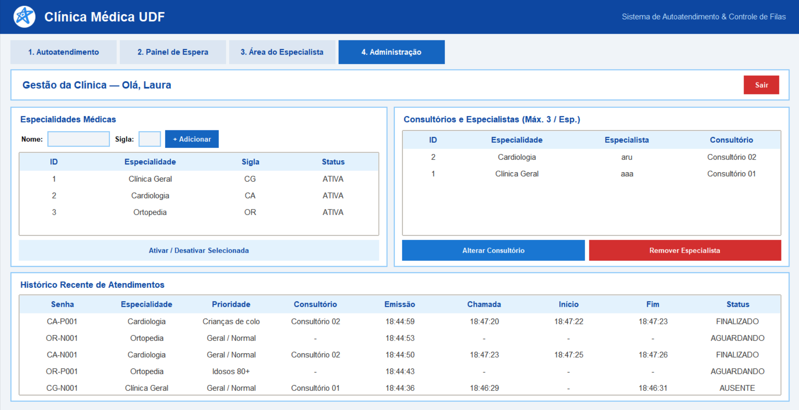

## Projeto_Final_Estrutura_de_dados
Sistema desktop em Python (Tkinter e SQLite) para gerenciamento de filas e senhas médicas. Possui totem de autoatendimento com triagem por 7 níveis de prioridade, painel de chamadas com tempo médio de espera, área do especialista para controle de consultas e módulo administrativo para gestão de especialidades, consultórios e histórico.

---


# Clínica Médica UDF — Sistema de Gerenciamento de Senhas

Projeto desenvolvido para a disciplina de **Estrutura de Dados II** — Centro Universitário UDF.

## Integrantes do Grupo

* **Arthur Esteves** (`@ArthurEUDF`)
* **Juan Moreira Braz** (`@Crustacomics`)
* **Marcos Vinnicyus Araujo** (`@vawkk`)
* **Maria Laura Silva** (`@lauredti`)

---

## Objetivo do Projeto

> Informar o fluxo de recepção e triagem de uma clínica médica que atende múltiplas especialidades como: **Clínica Geral**, **Cardiologia**, **Ortopedia** com possibilidade de expansão futura. O sistema resolve o problema de organização de filas mistas aplicando na prática conceitos de **Filas FIFO** e **Filas de Prioridade**, garantindo que pacientes preferenciais sejam atendidos na ordem correta de urgência sem perder o controle da ordem de chegada.

## Funcionalidades Desenvolvidas

O sistema é dividido em quatro páginas principais acessíveis por abas na interface:

1. **Autoatendimento (Paciente):**
   * Escolha da especialidade médica ativa em 3 etapas simples.
   * Coleta dos dados de triagem: **gênero**, **idade**, **gestante**, **lactante**, **necessidade especial (PCD)** e **obesidade**.
   * Seleção entre atendimento **Geral / Normal** ou **Prioritário / Preferencial**, com escolha obrigatória do subgrupo prioritário.
   * Geração de senha unindo a sigla da especialidade e o contador sequencial (ex.: `CG-N001`, `CA-P001`, `OR-N002`).
   * Exibição imediata da posição atual na fila e do tempo estimado de espera.

2. **Painel de Espera:**
   * Destaque para a última senha chamada, o consultório de destino, a especialidade e a categoria.
   * Histórico das últimas senhas chamadas na tela.
   * Listagem em tempo real dos próximos pacientes na fila já organizados pela ordem de prioridade, exibindo o total de pacientes aguardando e o tempo estimado por especialidade.

3. **Área do Especialista:**
   * Tela de login e autocadastro para médicos/especialistas com limite de até 3 profissionais por especialidade e validação de consultório único.
   * Chamada automática da próxima senha da sua especialidade respeitando a fila de prioridade.
   * Controle do ciclo de atendimento: **Chamar Próxima Senha**, **Iniciar Atendimento**, **Finalizar Consulta** ou **Marcar Ausência**.

4. **Administração:**
   * Acesso restrito por login (usuário padrão inicial: `admin` / senha: `123`).
   * Cadastro e ativação/desativação de especialidades médicas (bloqueando a desativação caso existam pacientes aguardando naquela fila).
   * Gerenciamento de especialistas e alteração de consultórios.
   * Consulta ao histórico completo de atendimentos com horários de emissão, chamada, início, fim e status final.


---

## Estruturas de Dados Utilizadas

Para garantir desempenho e organização, o módulo `filas.py` combina as seguintes estruturas de dados:

* **Fila de Prioridade:**
  Cada especialidade possui sua própria fila de prioridade gerenciada por um *heap* mínimo. Como o `heapq` sempre remove o menor valor primeiro, pacientes com nível de prioridade menor (mais urgente) saem na frente.
* **Fila FIFO:**
  Utilizada para manter o controle estrito de ordem de chegada dos atendimentos normais por especialidade, permitindo inserção e remoção nas extremidades em tempo $O(1)$.
* **Tabelas Hash / Dicionários:**
  Usados para mapear cada especialidade pelo seu `id` e associar cada subgrupo ao seu peso numérico, garantindo acesso instantâneo aos dados de cada fila independente.

---

##  Regras de Prioridade e Cálculo de Espera

### Política de Atendimento Prioritário

O sistema implementa uma regra de prioridade em **7 níveis**, onde **1 é a maior prioridade** e **7 é o atendimento comum**:

| Nível | Categoria / Subgrupo | Tipo de Senha |
| :---: | :--- | :---: | 
| **1** | Idosos 80+ | Urgente (`U`) |
| **2** | Idosos (60 a 79 anos) | Preferencial (`P`) |
| **3** | PCD (Pessoa com Deficiência) | Preferencial (`P`) | 
| **4** | Gestantes | Preferencial (`P`) | 
| **5** | Obesos | Preferencial (`P`) | 
| **6** | Crianças de colo | Preferencial (`P`) | 
| **7** | Geral / Normal | Normal (`N`) | 

**Como funciona o desempate:**
Quando dois ou mais pacientes possuem o **mesmo nível de prioridade**, o critério de desempate da tupla é o contador sequencial. Assim, quem chegou primeiro é atendido primeiro, preservando o comportamento **FIFO dentro de cada nível de prioridade**.


### Cálculo do Tempo Estimado de Espera

* O tempo médio adotado por consulta é de **30 minutos**.
* Quando uma senha é emitida, o sistema ordena a fila daquela especialidade conforme a regra de prioridade vigente e verifica quantos pacientes estão à frente daquela senha.
* **Hipótese de funcionamento:** Se não houver ninguém à frente, o tempo estimado é `0 minutos`. Caso chegue um paciente com prioridade mais alta posteriormente, as posições e estimativas no Painel de Espera são recalculadas automaticamente.

---

## Tratamento de Exceções e Validações

O sistema trata erros operacionais e entradas inválidas para evitar falhas durante o uso:

* **Fila vazia:** Impede a chamada de senha quando não há pacientes aguardando na especialidade, exibindo aviso amigável ao médico.
* **Atendimento em andamento:** Bloqueia o especialista de chamar uma nova senha antes de finalizar ou marcar ausência da senha atual.
* **Campos vazios ou inválidos:** Valida formulários de login, cadastro de especialistas, administradores e especialidades.
* **Duplicidade e limites:** Impede usuários repetidos, siglas de especialidades duplicadas, dois médicos no mesmo consultório e bloqueia o cadastro de mais de 3 especialistas na mesma especialidade.
* **Especialidade com fila ativa:** Impede que o administrador desative uma especialidade enquanto houver pacientes com status `AGUARDANDO`.

---

## Funções Implementadas por Módulo

### `filas.py` — Classificação, Geração de Senhas e Gerenciamento de Filas
* `classificar_paciente(genero, idade, gestante, lactante, pcd, obesidade)`: Valida os dados de triagem e retorna automaticamente a categoria (`Urgente`, `Preferencial` ou `Normal`) e o critério identificado.
* `GerenciadorFilas.emitir_senha(...)`: Classifica o paciente, incrementa o contador sequencial da categoria (`U`, `P` ou `N`), insere na fila de prioridade, persiste no banco SQLite e calcula a posição e o tempo de espera.
* `GerenciadorFilas.consultar_proxima(especialidade_id)`: Consulta a próxima senha a ser chamada sem removê-la da fila.
* `GerenciadorFilas.chamar_proxima(especialidade_id, consultorio)`: Remove a senha mais prioritária da fila, registra o consultório e atualiza o painel e o histórico.
* `GerenciadorFilas.atualizar_status_atendimento(codigo_senha, novo_status)`: Atualiza o estado da consulta para `EM_ATENDIMENTO`, `FINALIZADO` ou `AUSENTE`.
* `GerenciadorFilas.listar_fila_ordenada(especialidade_id)`: Retorna a fila ordenada por prioridade e ordem de chegada.
* `GerenciadorFilas.contar_por_categoria()`: Contabiliza quantos pacientes aguardam em cada categoria (`Urgente`, `Preferencial`, `Normal`).

### `autenticador.py` — Autenticação, Especialistas e Administração
* `autenticar_usuario(usuario, senha, perfil_esperado)`: Valida credenciais de especialistas e administradores.
* `cadastrar_especialista(...)`, `atualizar_consultorio_especialista(...)`, `remover_especialista(...)`: Gerenciam os profissionais e consultórios.
* `cadastrar_especialidade(...)`, `alternar_status_especialidade(...)`: Gerenciam especialidades médicas ativas e inativas.
* `listar_especialidades(...)`, `listar_profissionais()`, `listar_historico()`: Consultam os registros no banco de dados.

### `banco_dados.py` — Persistência SQLite
* `conectar()`: Abre conexão com o banco `clinica_medica.db` com chaves estrangeiras ativadas.
* `inicializar_banco()`: Cria as tabelas (`Especialidade`, `Usuarios`, `Profissional_Consultorio`, `Senha`, `Historico_Atendimento`) e insere dados iniciais padrão.

### `interface.py` e `principal.py` — Interface Gráfica e Execução
* `AplicacaoClinica`: Controla a navegação entre abas, formulários de triagem com validação, painel de espera em tempo real, sala do especialista e painel administrativo.
* `principal()`: Inicializa o banco de dados e inicia o loop principal da aplicação.

---

## Exemplos de Utilização

### Cenário 1: Geração e Classificação Automática de Senhas
1. Na aba **1. Autoatendimento**, o atendente ou paciente seleciona **Clínica Geral**.
2. Preenche os dados do primeiro paciente: Gênero `Masculino`, Idade `28`, nenhuma condição marcada → Sistema classifica como **Normal** e emite **`CG-N001`**.
3. Cadastra o segundo paciente: Gênero `Feminino`, Idade `30`, marca `Gestante` → Sistema classifica como **Preferencial** e emite **`CG-P001`**.
4. Cadastra o terceiro paciente: Gênero `Masculino`, Idade `84` → Sistema classifica como **Urgente** e emite **`CG-U001`**.

### Cenário 2: Ordem de Chamada e Painel de Espera
1. Na aba **2. Painel de Espera**, o contador exibe: `Total aguardando: 3 | Urgente (U): 1 • Preferencial (P): 1 • Normal (N): 1`, e a lista de próximos exibe a ordem exata: **`CG-U001`** → **`CG-P001`** → **`CG-N001`**.
2. Na aba **3. Área do Especialista**, o médico clica em **1. Chamar Próxima Senha**:
   * A primeira chamada chama **`CG-U001`** (Urgente), mesmo tendo sido emitida por último.
   * Após clicar em **2. Iniciar Atendimento** e **3. Finalizar Consulta**, a senha `CG-U001` é encerrada e não retorna à fila.
   * A chamada seguinte chama **`CG-P001`** (Preferencial) e, por fim, **`CG-N001`** (Normal).

---

##  Instruções de Instalação e Execução

Siga o passo a passo abaixo para preparar o ambiente e executar o sistema localmente.

### 1. Pré-requisitos do Sistema

Antes de começar, verifique se você possui:

* **Python 3.8 ou superior** instalado na máquina.
  * Para conferir sua versão, abra o terminal (ou Prompt de Comando / PowerShell) e digite:
    ```bash
    python --version
    ```
    *(No Linux ou macOS, pode ser necessário usar `python3 --version`)*.
* **Tkinter** (biblioteca de interface gráfica nativa do Python):
  * **Windows e macOS:** Já vem instalado junto com o instalador oficial do Python.
  * **Linux (Ubuntu / Debian):** Caso não esteja instalado, execute:
    ```bash
    sudo apt update && sudo apt install python3-tk
    ```

### Passo a Passo de Instalação

## Passo 1: Verifique se o Python está instalado
Abra o terminal ou Prompt de Comando / PowerShell e digite:
```bash
python --version
```
*(No Linux ou macOS, use `python3 --version`)*

## Passo 2: Entre na pasta do projeto
No terminal, vá até a pasta onde estão os arquivos `.py` do sistema:
```bash
cd caminho/da/pasta/do/projeto
```

## Passo 3: Instale a biblioteca Pillow
Digite o comando abaixo no terminal:
```bash
pip install pillow
```
*(Se usar Linux/macOS, pode ser `pip3 install pillow`).*

---

## Como Executar e Abrir a Interface

Com o terminal dentro da pasta do projeto, rode o arquivo principal:

* **No Windows:**
  ```bash
  python principal.py
  ```

* **No Linux / macOS:**
  ```bash
  python3 principal.py
  ```

Assim que você rodar esse comando:
1. O arquivo de banco de dados **`clinica_medica.db`** será criado automaticamente na pasta.
2. A janela principal do programa (**"Clínica Médica UDF — Sistema de Gerenciamento de Senhas"**) vai abrir na sua tela.



---

## Estrutura de Arquivos do Projeto

```text
sistema-clinica-medica/
├── principal.py        # Ponto de entrada: inicializa o banco e abre a janela Tkinter
├── interface.py        # Interface gráfica completa 
├── filas.py            # Lógica das filas FIFO (deque), Min-Heap (heapq) e cálculo de espera
├── autenticador.py     # Login, cadastro e gerenciamento de especialistas, ADMs e especialidades
├── banco_dados.py      # Criação das tabelas SQLite, conexão e dados iniciais padrão
├── imagens/
│   └── logo.png        # Logotipo exibido no cabeçalho da aplicação
│   └── inicial.png     # Imagem da tela inicial do projeto
│   └── senha.png       # Imagem do página de gerar senha
│   └── espera.png      # Imagem da página de espera
│   └── adm.png         # Imagem do painel do Administrador
└── README.md           # Documentação do projeto
